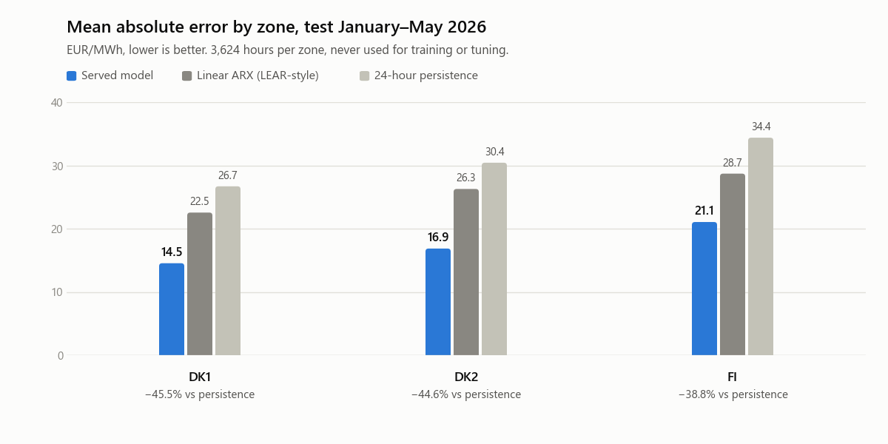
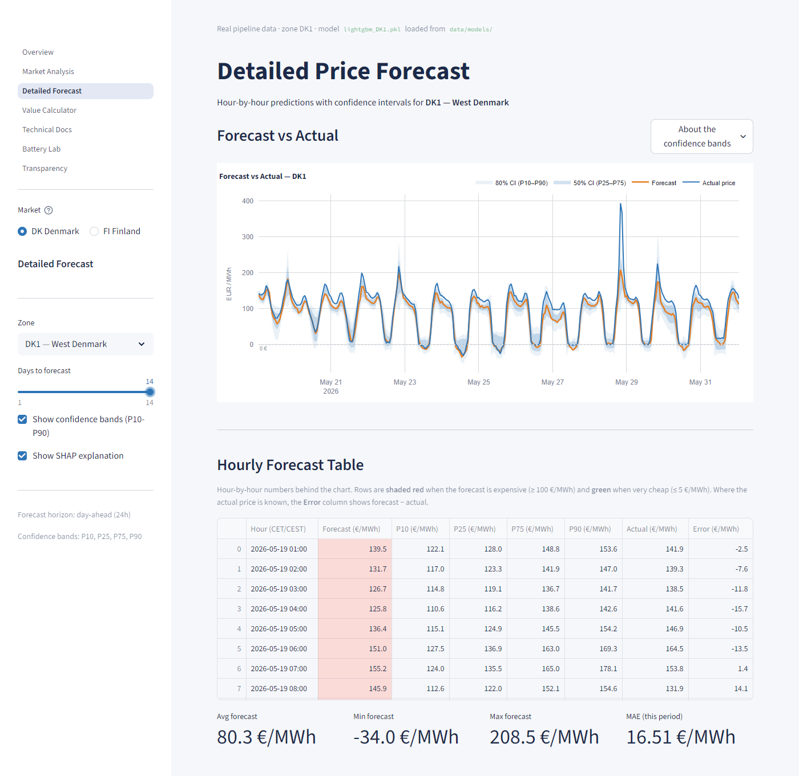
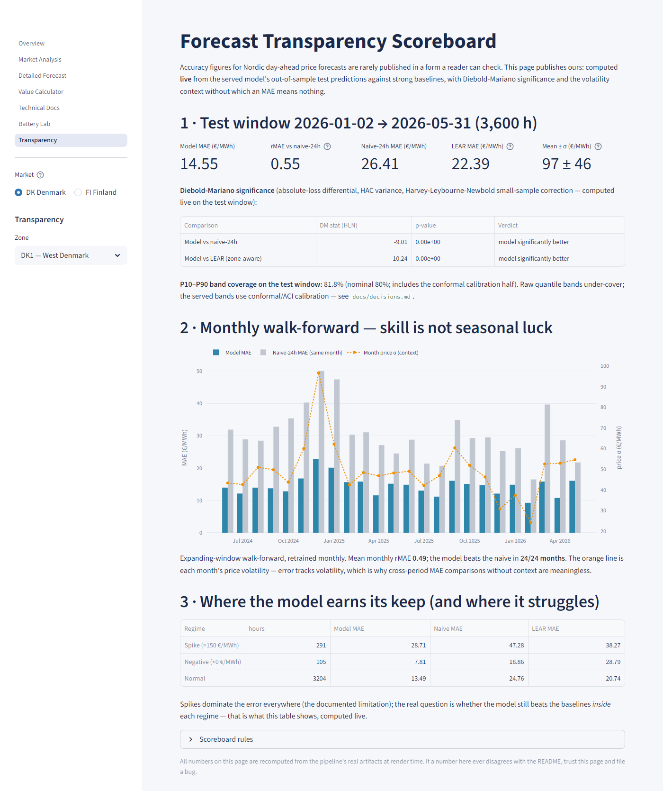
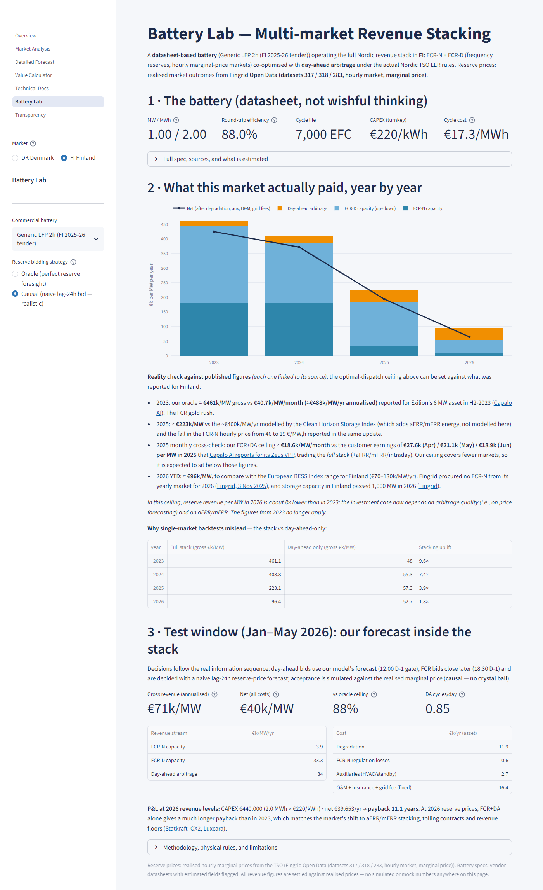

# Nord Pool electricity price forecasting and battery (BESS) simulator

[](https://github.com/davidsanzdeandino/nordic-power-price-forecast/actions/workflows/ci.yml)

Forecasts the 24 hourly day-ahead electricity prices of three Nordic bidding zones (Denmark West DK1, Denmark East DK2 and Finland FI), and measures what the forecast is worth in a battery-dispatch backtest. Data comes from five sources: ENTSO-E, Energi Data Service (Energinet), Fingrid, Open-Meteo and Yahoo Finance (gas and carbon prices, for personal research use only and never redistributed).

## Key results (test: January–May 2026, 3,624 hours per zone)

- MAE of 14.5 (DK1), 16.9 (DK2) and 21.1 (FI) EUR/MWh: 39–46% lower than 24-hour persistence and 27–36% lower than a linear ARX (LEAR-style) baseline.
- In Denmark, a 1 MW / 2 MWh battery dispatched on the project's forecasts earns 92–93% of the perfect-foresight profit (75% in Finland).
- P10–P90 intervals recalibrated with adaptive conformal inference reach 78% coverage, against 35–55% for the raw quantile bands.

<picture><source media="(prefers-color-scheme: dark)" srcset="docs/img/mae_by_zone_dark.png"></picture>

The full pipeline is here: data extraction from five sources, cleaning and integration, leakage-controlled feature engineering, LightGBM models tuned with Optuna, simple and linear baselines, statistical model comparison, calibrated prediction intervals, a linear-programming battery backtest and a seven-view Streamlit dashboard. A 29-step orchestrator (`run_pipeline.py`) runs it end to end, and a unit-test suite on synthetic data runs in CI.

Status: built between February and June 2026 and evaluated as a backtest on January to May 2026. It is not a live forecasting service. This repository is a cleaned public release, so the commit history starts at publication.

## The problem

Day-ahead prices are set in a single auction at 12:00 CET on the day before delivery (D-1), so a battery operator or a flexible consumer has to commit before it. Wind, hydro reservoirs, nuclear availability and coupling with Germany, Sweden and Estonia move Nordic prices, and spikes and negative prices are common. Goal: forecast every hour of day D with only the information published before the D-1 auction, beat standard baselines by a margin that holds up statistically, and turn the forecast into a measurable economic result.

## Results

Test window: 1 January to 31 May 2026 (UTC), 3,624 hourly prices per zone, never used for training or tuning. Prices in EUR/MWh.

### Point forecast of the served model

| Zone | Served model | MAE | vs persistence 24 h | vs linear ARX |
|---|---|---:|---:|---:|
| DK1 | LightGBM + AR correction | **14.54** | −45.5% | −35.5% |
| DK2 | LightGBM + AR correction | **16.86** | −44.6% | −35.8% |
| FI | Diverse ensemble + AR correction | **21.05** | −38.8% | −26.6% |

| Zone | RMSE | Directional accuracy | R² |
|---|---:|---:|---:|
| DK1 | 19.91 | 82.6% | 0.82 |
| DK2 | 25.70 | 82.0% | 0.76 |
| FI | 37.63 | 73.0% | n/a |

Directional accuracy: share of hours where the forecast gets the sign of the hour-to-hour price change right.

- rMAE (model MAE divided by persistence MAE): 0.545 (DK1), 0.554 (DK2), 0.612 (FI).
- Context: the mean test-window price was 96.6 (DK1), 99.8 (DK2) and 75.9 (FI) EUR/MWh, with standard deviations of 46.7, 52.0 and 70.7. The MAE is therefore about 15%, 17% and 28% of the mean price. Finland is the hardest zone: its price swings are about as large as the price itself.
- R² for FI was not computed for the served ensemble. The single LightGBM in FI reached 0.71, but that is not the model in the table.



*Detailed Forecast view, DK1, the last 14 days of the test window, with the P10–P90 and P25–P75 bands.*

### Baselines (same test window)

| Baseline | DK1 MAE / RMSE / DirAcc / R² | DK2 MAE / RMSE / DirAcc / R² | FI MAE / RMSE / DirAcc / R² |
|---|---|---|---|
| Persistence (same hour, 24 h earlier) | 26.69 / 38.82 / 78.2% / 0.31 | 30.42 / 45.65 / 79.6% / 0.23 | 34.38 / 52.43 / 67.5% / 0.45 |
| Weekly seasonal mean (same hour, last 4 weeks) | 29.07 / 38.88 / 80.6% / 0.31 | 33.78 / 45.25 / 81.6% / 0.24 | 52.07 / 69.70 / 68.0% / 0.03 |
| Linear ARX (LEAR-style, ridge, zone-aware) | 22.54 / 29.15 / 80.1% / 0.61 | 26.27 / 35.02 / 80.2% / 0.55 | 28.70 / 42.12 / 70.6% / 0.64 |

The LEAR-style baseline is a ridge regression (alpha 0.1) on price lags of 24, 48 and 168 to 174 hours, cyclical hour, weekday and month terms, a weekend flag, and the temperature and wind forecast of its own zone. It does not include the daily LASSO recalibration of the original LEAR.

### Robustness

- **Walk-forward validation.** Expanding window, retrained every month, 24 monthly folds from June 2024 to May 2026. Mean monthly MAE of the LightGBM: 14.50 (DK1), 15.53 (DK2) and 22.00 (FI). Monthly MAE ranges from 9.3 to 22.7 in DK1, from 11.4 to 21.4 in DK2 and from 9.5 to 34.2 in FI, so the result is not a one-season effect.
- **Model selection.** A Diebold-Mariano test compared the diverse ensemble with the single LightGBM on the test window. In Denmark the single LightGBM is significantly better (DM = +8.67 in DK1 and +11.98 in DK2). In Finland the ensemble is significantly better (DM = −8.71). All three have p < 0.001. Each zone serves the model the test favours.
- **Prediction intervals (P10–P90, target 80% coverage).** The raw LightGBM quantile bands are too narrow: 37.1% (DK1), 35.4% (DK2) and 55.0% (FI) coverage over the test window. Two corrections were measured:
  - Split-conformal calibration, fitted on the first half of the test window (to mid-March) and measured on the second half: 81.5%, 79.3% and 74.0%.
  - Adaptive conformal inference (Gibbs and Candès, 2021), updated online over the whole test window: 78.4%, 78.3% and 78.0%.
- **Proper scoring.** Pinball loss of 5.83, 7.35 and 8.28 EUR/MWh, and CRPS (approximated with 5 quantiles) of 11.66, 14.70 and 16.57.



*Transparency view, DK1. The page recomputes its numbers from the test predictions when it loads. It starts on 2 January (3,600 hours) because the first day is needed for the 24-hour lags, so its figures differ slightly from the tables above.*

### Economic value: battery arbitrage backtest

Setup: a 1 MW / 2 MWh battery with 90% round-trip efficiency. Each day, a linear program sets the charge and discharge schedule from the forecast, with charge plus discharge capped at the 1 MW rating in every hour, and the result is settled at the actual prices. It is compared with perfect foresight (the same LP on actual prices) and with a fixed schedule (charge 00:00–02:00, discharge 17:00–19:00, Copenhagen time for all three zones). Figures are annualised from the test window.

| Zone | Forecast-driven profit (EUR/yr) | Perfect foresight (EUR/yr) | Share of perfect foresight | Fixed schedule (EUR/yr) |
|---|---:|---:|---:|---:|
| DK1 | 68,555 | 74,033 | **93%** | 8,661 |
| DK2 | 75,867 | 82,349 | **92%** | 16,955 |
| FI | 40,508 | 54,065 | **75%** | 22,017 |

The fixed schedule is a weak reference, so the share of perfect foresight is the more meaningful number. This backtest runs on the evaluation-stage forecast (diverse ensemble with day-ahead AR correction) in all three zones. The interactive Value Calculator page uses the served forecast and its own default parameters, so its numbers differ slightly.

### Battery Lab: reserves plus arbitrage (Finland)

`pages/5_Battery_Lab.py` co-optimises day-ahead arbitrage with the Nordic frequency-containment reserves (FCR-N, FCR-D up and down) as a linear program. In every hour, charge plus discharge stays within the power rating, and the round-trip efficiency is applied once, split between charge and discharge. Results are settled against the realised reserve prices published by Fingrid. Battery parameters come from manufacturer datasheets (`src/model/battery_specs.py`).

- Perfect-foresight revenue ceiling in Finland for a generic 1 MW / 2 MWh battery, gross: 461.1 (2023), 408.8 (2024), 223.1 (2025) and 96.4 (2026, January to May, annualised) thousand EUR per MW. As more batteries joined the Finnish reserve markets, reserve prices fell, and the ceiling fell with them.
- In the 2026 test window the day-ahead schedule follows the price forecast. Reserve bids placed without knowing the reserve prices in advance (the same hour of the previous day times a bid margin, accepted only if the bid is at or below the realised clearing price) earn 71.2 thousand EUR per MW, gross. That is 88% of the 81.2 the same battery earns when reserve prices are known in advance. Day-ahead arbitrage alone gives 39.1. For a 2-hour commercial system (Sungrow PowerTitan 2.0, 2.5 MW / 5 MWh) the three figures are 74.6, 83.6 (89%) and 41.5.
- aFRR, mFRR and intraday markets are not modelled, so these figures are a lower bound for a battery that also trades in those markets.



### Where each number comes from

| Numbers | File |
|---|---|
| Served model MAE, RMSE, directional accuracy, R², linear ARX MAE | `data/metadata/served_metrics_DK1.json`, `_DK2.json`, `_FI.json` |
| Baselines | `results/baselines_test2026.json` |
| rMAE and percentage changes against the baselines, test-window price mean and standard deviation | `results/evaluation_test2026.json` |
| Diebold-Mariano, coverage (static, split-conformal, ACI), pinball and CRPS, battery backtest, evaluation-run models | `results/evaluation_test2026.json` |
| Walk-forward folds | `data/models/walkforward_DK1.csv`, `_DK2.csv`, `_FI.csv` (summary in `results/evaluation_test2026.json`) |
| Training runs (features, splits, Optuna trials, top features, single LightGBM R²) | `data/metadata/train_DK1_20260605_145726.json`, `train_DK2_20260605_151856.json`, `train_FI_20260606_091405.json` |
| Hourly master table size | `data/metadata/integration_20260605_144247.json` |
| Battery Lab | `results/battery_lab_fi.json` (output of `checks/test_revenue_stacking.py` and of the computation in `checks/test_battery_lab_data.py`) |

## How it works

```
ENTSO-E Transparency ─┐
Energi Data Service ──┤   src/extract/   src/transform/          src/model/
Fingrid Open Data ────┼─► 01-11 ───────► cleaning, integration ─► features ─► train ─► evaluate ─► predict
Open-Meteo ───────────┤                  (hourly master table,     │           │          │
Yahoo Finance (gas,   ┘                   Jan 2023 - May 2026)     │           │          └─► app.py + pages/
 CO2, via yfinance)                                                │           └─► baselines, DM test,
                                                                   │               conformal, battery LP
                                                                   └─► 166 features (DK), 224 (FI)
```

1. **Extraction** (`src/extract/`, pipeline steps 1–7 and 10–13). Day-ahead prices, load and generation (actuals and forecasts), wind and solar forecasts, cross-border flows and capacities, scheduled exchanges, unavailability notices and hydro reservoir levels come from ENTSO-E. They cover the Nordic zones plus the coupled German (DE-LU) market. The Danish TSO data comes from Energi Data Service, the Finnish TSO forecasts and reserve prices from Fingrid, the weather forecasts from Open-Meteo, and gas (TTF) and carbon (EUA) prices from Yahoo Finance.
2. **Integration** (`src/transform/`, steps 8–9). Everything is joined into one hourly table: 29,928 hours from January 2023 to May 2026. Steps 10–13 then add the Finnish coupling, Fingrid and reserve-price columns. Since 1 October 2025 the day-ahead market clears in 15-minute periods, and the pipeline averages any sub-hourly series to hourly.
3. **Features** (`src/model/features.py`, step 14). Price lags and rolling statistics, residual load (load forecast minus wind and solar forecasts) for each zone and for Germany, weather, reservoir anomalies, commodity prices, outages and calendar terms. In Denmark the most important feature is the German residual-load forecast; in Finland it is Fingrid's own residual-load forecast.
4. **Training** (`src/model/train.py`, steps 18–20). Fixed time split: train to 30 September 2025, validation October to December 2025, test January to May 2026. Optuna runs 100 trials on the validation quarter. The final models are refit on train plus validation. Quantile models give the P10, P25, P75 and P90 bands. A small autoregressive model on recent residuals (order 1 to 3, chosen by AIC) adjusts each day's forecast. For Finland, the served model averages three LightGBM models trained with L2, median and Huber objectives.
5. **Evaluation** (`src/model/baselines.py`, `src/model/evaluate.py`, steps 15–17 and 21–23). Baselines, Diebold-Mariano test, interval coverage, pinball loss and CRPS, error by hour and season, and the battery backtest. Steps 24–26 check the day-ahead prediction of each zone, and steps 27–29 measure the served model and write `data/metadata/served_metrics_<zone>.json` (`scripts/gen_served_metrics.py` for DK1 and DK2, `scripts/evaluate_fi_regimes.py` for FI).
6. **Dashboard** (`app.py`, `pages/`). Seven views: overview, market analysis, detailed forecast with SHAP explanations, value calculator, technical documentation, Battery Lab, and transparency (monthly error against the baselines).

### Preventing leakage

The model may only use what is known at the D-1 auction:

- Price lags are at least 24 hours, and rolling statistics are computed on the series already shifted by 24 hours.
- Load, wind and solar enter as day-ahead forecasts, never as realised values.
- Weather comes from Open-Meteo's Historical Forecast API: the forecast that was issued, not reanalysis.
- The German day-ahead price clears in the same auction, so it enters lagged by 24 hours. Only the German forecasts, published before the auction, enter at the same hour.
- Spreads, capacity use and commodity prices are lagged by 24 hours, and reservoir levels by one week. Congestion flags derived from same-hour prices are excluded.
- The day-ahead AR correction only uses residuals up to the end of D-1, whose prices were set the day before.
- No random shuffling at any point. Validation and walk-forward are strictly chronological.

`tests/test_features_leakage.py` checks the first and the fifth rules on synthetic data: changing any price or flow after D-1 must leave every feature unchanged, and no same-hour price, spread, flow, capacity, load or congestion column may reach the training matrix.

## Reproducing the results

Requirements: Python 3.11, a free ENTSO-E API token and, for Finland, a free Fingrid Open Data key. Energi Data Service, Open-Meteo and Yahoo Finance need no key.

```bash
git clone https://github.com/davidsanzdeandino/nordic-power-price-forecast.git
cd nordic-power-price-forecast
python -m venv venv
source venv/bin/activate          # Windows: venv\Scripts\activate
pip install -r requirements.txt

cp .env.example .env              # add ENTSOE_API_KEY and FINGRID_API_KEY
```

How to get the keys:

- ENTSO-E: register at transparency.entsoe.eu and request API access, as described in `.env.example`.
- Fingrid: register at data.fingrid.fi and subscribe to the free Open Data product.

Run the pipeline:

```bash
python run_pipeline.py                 # all 29 steps (with Optuna, slow)
python run_pipeline.py --fast          # same, without Optuna (much faster, slightly different models)
python run_pipeline.py --step 3        # a single step (here, the Open-Meteo extraction)
python run_pipeline.py --from 14       # from feature engineering onwards
python run_pipeline.py --zone FI       # shared steps plus the FI steps only

streamlit run app.py
```

| Steps | What they do |
|---|---|
| 1–7 | Extraction: ENTSO-E prices, physical data, unavailability, reservoirs and scheduled exchanges; Open-Meteo; Energi Data Service; Yahoo Finance |
| 8–9 | Cleaning and integration into the hourly master table |
| 10–13 | Additions to the master table: Finnish coupling, Fingrid forecasts, Fingrid and Energinet reserve prices |
| 14 | Feature engineering |
| 15–17 | Baselines for DK1, DK2 and FI |
| 18–20 | Training for DK1, DK2 and FI (LightGBM, Optuna, quantiles, conformal calibrator, AR correction, ensemble) |
| 21–23 | Evaluation for DK1, DK2 and FI |
| 24–26 | Day-ahead prediction check for DK1, DK2 and FI |
| 27–29 | Served-model metrics, written to `data/metadata/served_metrics_<zone>.json`; skipped if the zone's model is missing |

Without the data and models produced by the pipeline, the dashboard starts in demo mode with simulated values and a clear banner on every page. The Battery Lab and Transparency pages need the master table and do not start without it. The screenshots in this README come from a full local run.

Random seeds are fixed (`random_state=42`, Optuna TPE sampler seed 42). Re-downloading the data can still change results slightly, because the sources revise past values.

### Tests

```bash
pip install pytest==9.1.1 ruff==0.17.2
ruff check .
pytest
```

`tests/` holds 42 unit tests that run on synthetic data, with no network access and no keys: feature leakage, the battery linear programs (state of charge, power limits, profit never above perfect foresight), conformal coverage, the zone-aware LEAR baseline, the 15-minute to hourly aggregation and the per-zone deduplication of Energi Data Service rows. All of them pass. GitHub Actions runs the same lint and tests on every push and pull request (`.github/workflows/ci.yml`).

`checks/` holds manual checks that need the local data and trained models (Battery Lab data, revenue stacking, the DK2 reserve stack and the render of the Battery Lab and Transparency pages). They print their results and are not collected by pytest.

## Repository structure

```
app.py                      dashboard entry point (sidebar navigation)
pages/                      the seven dashboard views (0_Overview.py is the landing page)
run_pipeline.py             orchestrates the 29 pipeline steps
src/extract/                one script per dataset (11 extractors over 5 sources)
src/transform/              cleaning and integration into the hourly master table
src/model/                  features, training, baselines, AR correction, ensemble,
                            conformal intervals, evaluation, battery backtest, revenue stacking
src/data_loader.py          data access for the dashboard (demo mode if data is missing)
src/utils/                  logging
scripts/                    experiments (asinh transform, robust objectives, MLP member,
                            walk-forward, FCR price forecast) and the served-metrics scripts
tests/                      unit tests on synthetic data (pytest, run in CI)
checks/                     manual check scripts (need local data and models)
data/metadata/              metrics of the final runs (JSON)
data/models/walkforward_*   walk-forward folds (CSV)
results/                    baseline, evaluation and Battery Lab metrics for the test window
docs/decisions.md           design log: every technical decision and its evidence
docs/data_dict.md           data dictionary
docs/roadmap.md             technical roadmap, ranked by evidence
docs/img/                   figures used in this README
.github/workflows/ci.yml    lint and tests on GitHub Actions
pyproject.toml              ruff and pytest configuration
```

`data/raw`, `data/clean`, the master table and the trained models are not included (see the next section). Code comments, `docs/decisions.md` and `docs/data_dict.md` are written in Spanish.

## Data sources, licences and attribution

This repository contains code and aggregated results only. No third-party data series are redistributed: the pipeline downloads everything at run time with your own keys.

| Source | Data used | Terms | In this repository |
|---|---|---|---|
| ENTSO-E Transparency Platform (transparency.entsoe.eu) | Day-ahead prices, load, generation, forecasts, flows, capacities, unavailability, reservoir levels | ENTSO-E terms and conditions. Only the datasets on ENTSO-E's list of data available for free re-use are CC BY 4.0 | Code only |
| Energi Data Service, Energinet (energidataservice.dk) | Danish day-ahead prices up to 30 September 2025, balance and settlement data, reserve and imbalance prices | Conditions for use of Danish public-sector data | Code only |
| Fingrid Open Data (data.fingrid.fi) | Finnish load, wind and solar forecasts, reserve and imbalance prices | CC BY 4.0 for datasets produced by Fingrid | Code only |
| Open-Meteo (open-meteo.com) | Historical weather forecasts | CC BY 4.0 data; the free API is for non-commercial use | Code only |
| Yahoo Finance, via yfinance | TTF gas front-month (TTF=F) and a physically backed EUA carbon ETC (CO2.L) | Yahoo terms of service; personal use only | Code only |

Day-ahead prices originate from the Nordic day-ahead market (Nord Pool and the other power exchanges operating in the Nordic zones) and are obtained through the ENTSO-E Transparency Platform and Energi Data Service. No price series are redistributed here; the screenshots show a few days for illustration only.

Attribution:

- Source: ENTSO-E Transparency Platform (transparency.entsoe.eu). CC BY 4.0 where applicable; data were resampled to hourly resolution and cleaned. ENTSO-E does not endorse this project.
- Contains data used pursuant to "Conditions for use of Danish public-sector data" from the Energi Data Service portal (www.energidataservice.dk). Energinet does not endorse this project.
- Source: Fingrid, data.fingrid.fi, licence CC BY 4.0 (https://creativecommons.org/licenses/by/4.0/). Data were resampled to hourly resolution.
- Weather data by Open-Meteo.com (https://open-meteo.com), licence CC BY 4.0.
- Gas and carbon prices are downloaded at run time with yfinance from Yahoo Finance for personal research use and are not included. yfinance is not affiliated with Yahoo.

## Limitations

- **Short test window.** Five months, winter and spring only. The literature recommends at least a year. The 24-month walk-forward covers every season, but its hyperparameters were tuned on the October to December 2025 validation quarter, which falls inside the walk-forward period, so it is slightly optimistic for the months before that quarter.
- **Spikes dominate the error.** RMSE is well above MAE (37.6 vs 21.1 in Finland, 19.9 vs 14.5 in DK1). Extreme hours are hard to predict.
- **Hourly target.** The model forecasts the hourly average, while the day-ahead market has cleared in 15-minute periods since October 2025.
- **Model selection.** The Diebold-Mariano test compared the models without the AR correction. With the correction applied in the evaluation run, the DK1 ensemble had a slightly lower MAE (14.34) than the served LightGBM. Redoing the selection with the correction included is open work.
- **Two measurement runs.** The served-model metrics were measured on 10 June 2026 on the final feature table. The evaluation script's run from 5 June, on the earlier table, gives a single-LightGBM MAE of 14.82 (DK1) and 17.14 (DK2). Both runs use the same test window and the same trained models.
- **Interval calibration.** The split-conformal calibrator is fitted on the first half of the test window, so band coverage is only out-of-sample for the second half. Coverage ends close to the 80% target but not exactly on it: 81.5% (DK1), 79.3% (DK2) and 74.0% (FI) with split-conformal, and 78.0–78.4% with ACI.
- **Proxy inputs.** The carbon price is a physically backed ETC, not the ICE EUA settlement. Gas is the TTF front-month future.
- **Danish prices and the retired Energi Data Service dataset.** Energinet stopped publishing the Energi Data Service dataset `Elspotprices` on 30 September 2025, when the day-ahead market moved to 15-minute periods. Pipeline step 4 (`src/extract/04_energinet_dk.py`) still requests it for the whole period and gets rows only up to that date. In the June 2026 run behind the published results, step 4 and the cleaning step removed duplicate rows by timestamp alone, which kept one zone per hour, DK2 (24,094 hourly rows). So in that run `price_DK1` comes from the ENTSO-E day-ahead prices of step 1 (aggregated to hourly) for the whole period, and `price_DK2` comes from Energi Data Service up to 30 September 2025 and from ENTSO-E after that date, filled in by the integration step. Over those 24,094 hours the two sources agree on DK2 to within 0.0001 €/MWh. Duplicates are now removed by timestamp and zone (DT-23 in `docs/decisions.md`), so a new run also takes DK1 from Energi Data Service up to 30 September 2025. If the request ever returns an error, the error is logged, the dataset is skipped and ENTSO-E becomes the only source for the Danish prices. In every case the Danish prices after 30 September 2025 come from ENTSO-E alone, without the cross-check against a second source. The pipeline does not read any newer Energi Data Service price dataset.
- **Backtest, not operations.** The battery results assume a price-taking battery, perfect execution and no intraday or balancing trading. Degradation and fees are only modelled in the dashboard calculators and the Battery Lab.

## Licence

The code is released under the MIT Licence (see `LICENSE`). The licence covers the code in this repository only. Data downloaded by the pipeline stays under each provider's terms, listed above.

## Author

David Sanz de Andino Díez, Telecommunications Engineering student at Universidad Carlos III de Madrid. [LinkedIn](https://www.linkedin.com/in/davidsanzdeandino) · [GitHub](https://github.com/davidsanzdeandino)
